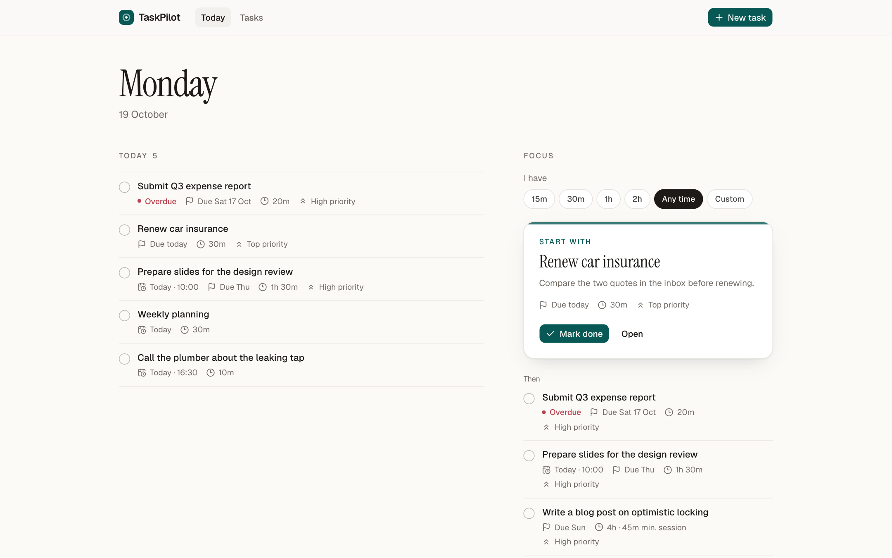
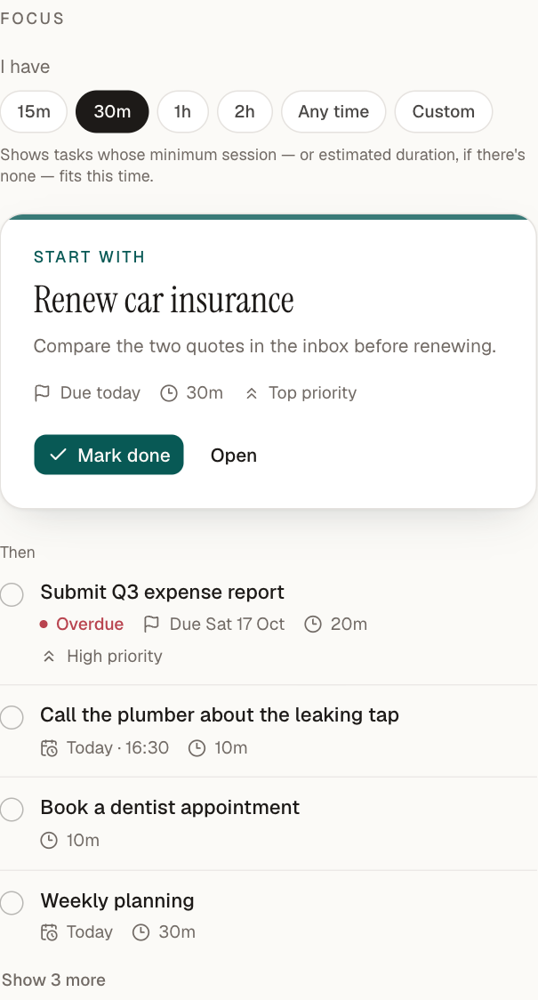
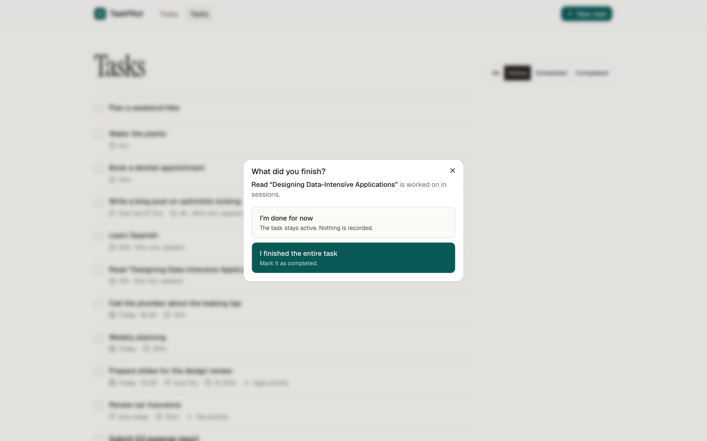
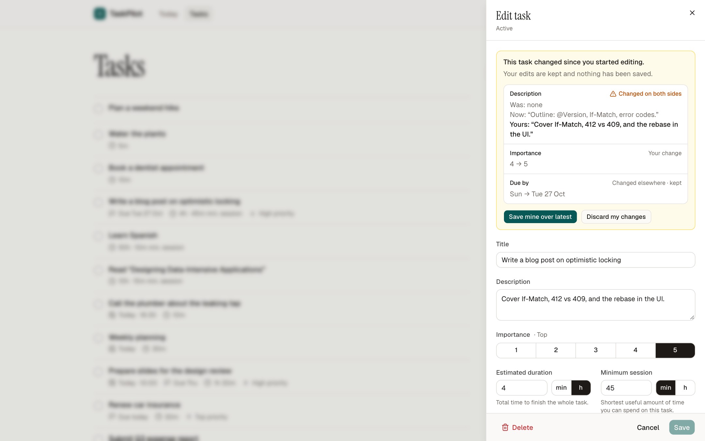

# TaskPilot

[](https://github.com/shirshelly/TaskPilot/actions/workflows/ci.yml)

A single-user personal task manager built to answer two questions well:

1. **What do I have today?** — a time-critical Agenda.
2. **What should I focus on right now?** — ranked recommendations that fit the time you have.

It's a **backend-focused** portfolio project: a Spring Boot service with a real domain model, a
lifecycle state machine, transactions and optimistic locking, background activation, and
timezone-correct date logic — plus a deliberately small React frontend that presents the
backend's decisions without re-implementing them.

> **Status:** V1 is complete — backend and interactive frontend are implemented and tested, and
> run locally. Authentication, deployment and multi-user support are not part of V1.



**Engineering at a glance:** domain-modelled task lifecycle · PostgreSQL transactions ·
optimistic concurrency with `If-Match` · background scheduling · deterministic recommendations ·
timezone-correct dates · integration tests against real PostgreSQL

## What it does

- **See what's on today.** An Agenda of everything scheduled for today or due by today —
  including anything left over from earlier days — with the most time-critical first.
- **Pick what to do next.** Say how much time you have; get your actionable tasks ranked by
  importance, deadline urgency and age, with one featured suggestion.
- **Keep "start on" and "due by" apart.** A task can be hidden until the day it becomes relevant,
  have a deadline, or both. Scheduled tasks reappear automatically on their date.
- **Make progress in short sessions.** Give a long task a minimum session (*read a book: 10 h
  total, 10 min at a time*) and it can be suggested for short slots. When you tick it off you
  choose between *I'm done for now* and *I finished the entire task*.
- **Edit safely.** If a task changed elsewhere while you were editing, nothing is overwritten:
  your draft is kept and you choose what to keep.
- **Look back.** Completed tasks are grouped by day, week and month.

**Focus panel with 30 minutes available**



**Finishing a session vs. finishing the task**



**Reviewing a conflicting edit**



More screenshots: [completed groups](docs/screenshots/completed-groups.png),
[quick create with hours](docs/screenshots/quick-create.png),
[edit sheet](docs/screenshots/edit-sheet.png), [mobile Today](docs/screenshots/today-mobile.png),
[mobile edit sheet](docs/screenshots/edit-sheet-mobile.png).

## Architecture

```text
React (Vite) ── /api (dev proxy) ──▶ Controller (HTTP, DTOs, If-Match)
                                  │
                               Service (transactions, orchestration)
                                  │
                               Task (domain: lifecycle + invariants)
                                  │
                               Repository (JPA) ──▶ PostgreSQL (Flyway-owned schema)

Beside the task flow:  agenda/  (query + ordering)   recommendation/  (eligibility → ranking)
                       scheduling/  (activation worker, one transaction per task)
```

**Who decides what.** The backend is the source of truth for every business rule; the frontend
presents results and handles input.

| Backend | Frontend |
|---|---|
| Lifecycle transitions and their validation | Shows only actions that make sense for a status (server still validates) |
| Agenda membership and order | Renders the Agenda exactly in the returned order |
| Recommendation eligibility and ranking | Featured card + alternatives in the returned order; never re-sorts |
| `isOverdue`, "today", activation | Displays them; reads the app timezone from `GET /app-info` |
| Optimistic locking, `If-Match` (412/409) | Minimal PATCH diff, conflict review and rebase |
| Durations stored as positive integer minutes | Minutes/hours input and exact conversion |
| — | Session-aware completion prompt; grouping of completed tasks by date |

**Stack.** Java 21 · Spring Boot 4.1 · Spring Data JPA / Hibernate · PostgreSQL 16 · Flyway ·
JUnit 5 · Mockito · Testcontainers — React 19 · TypeScript · Vite · Tailwind CSS · shadcn/ui
(Radix) · TanStack Query · React Router · Vitest · Testing Library.

## Engineering highlights

- **Rich domain model.** `Task` owns `complete`, `reopen`, `schedule`, `activate` and its
  invariants; `status` can't be set directly anywhere. The database repeats key invariants as
  `CHECK` constraints.
- **Concurrency.** `Task` is versioned with JPA `@Version`; `PATCH` honours `If-Match` (412 before
  anything is applied), and a commit-time race is a 409. The activation worker isolates conflicts
  per task.
- **Agenda and scheduling.** The Agenda is ordered by urgency tiers (missed deadline, missed
  schedule, due today, due soon, planned) using dates only. A background worker activates
  scheduled tasks on their date and catches up after downtime.
- **Structured errors.** RFC 9457 Problem Details with stable codes (`VALIDATION_FAILED`,
  `TASK_NOT_FOUND`, `INVALID_STATE_TRANSITION`, `VERSION_CONFLICT`, …); clients branch on codes,
  never on messages.
- **Time.** An injected `Clock` and one configured zone drive "today", overdue, activation and
  Agenda queries; the UI uses the same zone, with DST-tested conversions.
- **Eligibility vs. ranking.** Recommendations filter first (actionable, fits the time) and rank
  second; the minimum session only affects the filter, never the score.
- **Server state in the UI.** TanStack Query with one invalidation root, server-confirmed
  mutations (no optimistic guesses about derived views), 60 s polling while visible, refetch on
  focus, and a refresh at midnight in the app zone.

A longer list of design decisions is in [`docs/DESIGN-DECISIONS.md`](docs/DESIGN-DECISIONS.md); the
full design (domain, API, ordering, error contract, frontend conventions) is in
[`docs/V1-DESIGN.md`](docs/V1-DESIGN.md).

## Running locally

**Prerequisites:** Java 21, Docker, Node.js 22 (22.22.2 or later; the line CI tests). The
frontend's dependencies also accept 24.15+ and 26+, but not 23 or 25.

**1. PostgreSQL.** The first time, create the container:

```bash
docker run -d --name taskpilot-postgres \
  -e POSTGRES_DB=taskpilot -e POSTGRES_USER=taskpilot -e POSTGRES_PASSWORD=taskpilot \
  -p 127.0.0.1:5432:5432 postgres:16
```

After that, start the existing container (if it is already running, there is nothing to do —
`docker ps` shows it):

```bash
docker start taskpilot-postgres
```

These credentials are for local development only; don't reuse them anywhere else.

If port 5432 is already in use, choose another host port and keep the `127.0.0.1` prefix, for
example `-p 127.0.0.1:55432:5432`. Then start the backend in step 2 with
`DB_URL=jdbc:postgresql://localhost:55432/taskpilot ./mvnw spring-boot:run`.

**2. Backend** — in one terminal, from the repository root (port 8080; Flyway applies the
migrations on startup):

```bash
./mvnw spring-boot:run
```

**3. Frontend** — in a second terminal (port 5173; the dev server proxies `/api/*` to the
backend):

```bash
cd frontend
npm install   # first time only
npm run dev
```

Open <http://localhost:5173>. Configuration is by environment variable (defaults in
`application.yml`):

| Variable | Default |
|---|---|
| `DB_URL` / `DB_USERNAME` / `DB_PASSWORD` | `jdbc:postgresql://localhost:5432/taskpilot` / `taskpilot` / `taskpilot` |
| `APP_ZONE_ID` | `Asia/Jerusalem` |
| `APP_ACTIVATION_ENABLED` / `APP_ACTIVATION_FIXED_DELAY` | `true` / `PT5M` |
| `TASKPILOT_API_URL` (frontend dev proxy target) | `http://localhost:8080` |

To experiment without touching your data, use a second database:
`docker exec taskpilot-postgres createdb -U taskpilot taskpilot_dev` and start the backend with
`DB_URL=jdbc:postgresql://localhost:5432/taskpilot_dev ./mvnw spring-boot:run`. If you chose
another host port in step 1, use it in place of `5432`.

## API

| Method & path | Purpose | Success |
|---|---|---|
| `POST /tasks` | Create (status is derived, never sent) | `201` |
| `GET /tasks/{id}` | Read one | `200` |
| `GET /tasks[?status=ACTIVE\|SCHEDULED\|COMPLETED]` | List; newest first (`COMPLETED`: most recently completed first) | `200` |
| `PATCH /tasks/{id}` | Partial update of `title`, `description`, `importance`, `estimatedDurationMinutes`, `minSessionMinutes`, `deadline`; optional `If-Match` | `200` |
| `DELETE /tasks/{id}` | Hard delete | `204` |
| `POST /tasks/{id}/complete` · `/reopen` · `/schedule` | Lifecycle commands | `200` |
| `GET /agenda/today` | Today's Agenda, most time-critical first | `200` |
| `GET /recommendations[?availableMinutes=N]` | Ranked actionable tasks | `200` |
| `GET /app-info` | Application timezone for clients | `200` |

`PATCH` distinguishes an omitted field (unchanged) from an explicit `null` (cleared) and rejects
unknown or lifecycle fields.

## Testing

```bash
./mvnw clean test          # Docker required (Testcontainers PostgreSQL 16)
cd frontend
npm test                   # Vitest + Testing Library
npm run typecheck && npm run lint && npm run build
```

Business rules are tested at the lowest layer that owns them: domain unit tests for lifecycle and
invariants, ranker and Agenda-ordering unit tests, PostgreSQL integration tests (mapping,
constraints, optimistic locking, timezone boundaries), API tests through MockMvc against real
PostgreSQL, and worker tests with a fixed clock. Frontend tests cover the PATCH diff and conflict
rebase, DST-aware time helpers, duration parsing, error handling, completed-task grouping, and
the main interactions. GitHub Actions runs the backend tests and the frontend lint, tests and
build on every push and pull request to `main`.

## Design decisions and trade-offs

- **Server-confirmed UI, broad invalidation.** Simpler and always correct; costs a few extra GETs.
- **Agenda sorted in Java, not SQL**, to reuse the domain's overdue rules; database pagination of
  the Agenda would require moving the rule into the query.
- **412 vs 409** for version conflicts: precondition failed before applying vs. lost a race at
  commit; same `VERSION_CONFLICT` code. A version check can flag unrelated changes (e.g. the
  worker activating the task); the review UI makes those one click to resolve.
- **Session-aware completion is a UX convention**, not a backend task type: "I'm done for now"
  records nothing, because V1 has no time tracking.
- **Presentation logic stays in the frontend** (date grouping, minutes/hours), business rules stay
  in the backend, and the API carries only minutes and instants.

## V2 ideas

- **Time tracking and session history** — log sessions, time spent and progress per task, so
  "I'm done for now" can record what was done and recommendations can consider remaining work.
- Recurring tasks, task dependencies, and a schedule generator for today/tomorrow.
- Calendar view and integration; natural-language capture and a tool-calling assistant
  (see [`docs/AI-ROADMAP.md`](docs/AI-ROADMAP.md)).
- Authentication and multi-user support; deployment (static frontend + reverse proxy).
